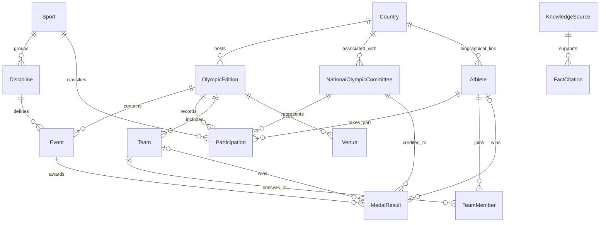

# База знаний OLYMPIC ATLAS

## 1. Назначение

OLYMPIC ATLAS связывает проверяемые факты об Олимпийских играх в SQLite. Prisma обслуживает каталоги и аналитические запросы. SQLite FTS5 и правила вывода используют те же сущности и источники.

## 2. Предметная область и сущности

- `OlympicEdition` — конкретное летнее или зимнее издание с официальным годом, фактическими датами и местом проведения.
- `Country` — государство или территория с регионом и возможным историческим периодом существования.
- `NationalOlympicCommittee` — олимпийская делегация. Она отделена от страны, поэтому исторический НОК не обязан совпадать с современным государством.
- `Athlete` — спортсмен и краткая подтверждённая биография.
- `Sport` и `Discipline` — двухуровневая спортивная таксономия.
- `Event` — соревнование конкретного издания в конкретной дисциплине.
- `Participation` — факт участия спортсмена в издании за определённый НОК и в определённом виде спорта.
- `Team` и `TeamMember` — командная заявка и её состав.
- `MedalResult` — одна медальная позиция события: индивидуальный спортсмен или команда, но не оба одновременно.
- `Venue` — объект проведения соревнований.
- `KnowledgeSource` и `FactCitation` — источник и связь источника с конкретным полем факта.

## 3. ER-диаграмма

`FactCitation` использует тип и идентификатор сущности, чтобы один механизм происхождения данных мог сопровождать факты всех доменных таблиц.

## 4. Примеры фактов

- издание `tokyo-2020` имеет официальный год 2020, но даты проведения находятся в 2021 году;
- участие связывает Симону Байлз, Рио 2016, НОК США и спортивную гимнастику;
- медальный результат связывает событие, тип медали, спортсмена или команду и НОК;
- источник IOC связан с результатом через `FactCitation`, поэтому факт можно проверить независимо от интерфейса.

## 5. Правила целостности

- уникальны slug изданий, спортсменов, видов спорта, дисциплин, событий и команд;
- уникальны код страны, код НОК и URL источника;
- сочетание года и сезона издания уникально;
- участие уникально по спортсмену, изданию, НОК и виду спорта;
- `resultKey` гарантирует идемпотентность медального результата;
- приложение проверяет XOR-инвариант результата: заполнен ровно один из `athleteId` и `teamId`;
- командная медаль хранится одной строкой `MedalResult`, а состав — в `TeamMember`, поэтому медаль не умножается на число участников;
- каскадное удаление применяется только к зависимым данным, а исторические связи со страной используют `SetNull` там, где потеря сущности недопустима.

## 6. Источники и проверка

Seed использует официальные страницы Olympics.com, материалы IOC и официальную библиотеку Олимпийского движения. Для каждого издания, биографии, участия и медального результата создаётся цитата. `accessedAt` фиксирует дату проверки; `reliability=OFFICIAL` обозначает первичный официальный источник.

## 7. Примеры запросов к знаниям

- спортсмены с золотом на разных изданиях: группировка `MedalResult` по `athleteId`, фильтр `GOLD`, `COUNT(DISTINCT editionId) > 1`;
- делегации с медалями в виде спорта: `MedalResult → Event → Discipline → Sport` с группировкой по `nocId`;
- спортсмены делегации: фильтр `Participation.nocId` с включением `Athlete`;
- дисциплины программы издания: `OlympicEdition → Event → Discipline`;
- источники результата: `FactCitation(entityType="MedalResult", entityId=...) → KnowledgeSource`.

## 8. Почему это база знаний, а не справочник

OLYMPIC ATLAS хранит атомарные факты, временную и делегационную принадлежность, типизированные связи и происхождение утверждений. Один факт повторно используется в каталогах, профилях, статистике и интерактивном графе. Составные ответы можно получать запросами к этим связям.

## 9. Объяснимый логический вывод

`/explore` распознаёт десять классов вопросов, разрешает названия через индекс SQLite FTS5 и выполняет проверяемые правила над существующими ключами и связями. Ответ содержит исходные записи, цитаты и отметку покрытия. Прямые ссылки на цепочки проверяются в репозитории графа перед подсветкой. [Архитектура и примеры](./REASONING_ENGINE.md)

## 10. Профиль спортсмена и массовый импорт

`Athlete` дополнен альтернативными именами, датами и местом рождения, специализацией, внешними идентификаторами, статусом полноты и атрибуцией изображения. `countryId` остаётся биографической связью; историческая делегация определяется только через `Participation.nocId` для конкретного издания. Гражданство Wikidata не превращается автоматически в олимпийское участие.

Импорт использует открытые Wikidata Query Service и Wikidata API. Внешний `wikidataId` уникален, пакет записывается через `upsert`, checkpoint позволяет продолжить работу после ограничения частоты. Wikimedia Commons API проверяет лицензию изображения до сохранения. `FactCitation` связывает базовый профиль с Wikidata, официальные результаты прежней выборки продолжают ссылаться на IOC/Olympics.

## Аналитический слой

Серверный репозиторий `src/lib/repositories/analytics.ts` читает официальные поля `OlympicEdition` вместе с их `FactCitation` и отдельными запросами агрегирует `Participation`, `MedalResult` и `TeamMember`. Общая проверка цитат по полям действует также в каталоге Игр и карточках. Пакет `prisma/data/release-audit.ts` хранит точечные поправки и записывает происхождение проверенных показателей и шести результатов одной транзакцией. В сравнении стран спортивные результаты связываются через `NationalOlympicCommittee.countryId`, а биографические профили — через `Athlete.countryId`. СССР (`URS`) и Объединённая команда (`EUN`) добавлены справочной миграцией с цитатами.

[Формулы, фильтры и ограничения аналитики](./ANALYTICS.md).

В локальном срезе 310 спортсменов, у 142 есть активная ссылка на фотографию Commons. Контрольная точка хранит позицию обхода и счётчик обработки. Для сводок используются фактические строки SQLite. Фото остаются внешними ресурсами и при сбое загрузки заменяются инициалами. Серверный каталог выдаёт до 48 профилей за запрос, а форма сравнения получает до 24 совпадений поиска и сохраняет выбранные профили.

Командная медаль хранится одной строкой `MedalResult` у `Team`; профиль получает её через `TeamMember`. Серверный расчёт объединяет прямые и командные строки по идентификатору и не умножает награду на число членов команды.

## 11. Исследование графа

Страница `/knowledge-graph` строит типизированный граф из текущих записей SQLite. Соседи загружаются страницами, а инспектор связи показывает исходную строку и доступную цитату. [Формальная модель и поиск путей](./KNOWLEDGE_GRAPH.md)
