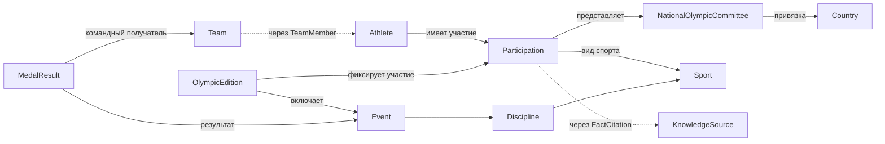
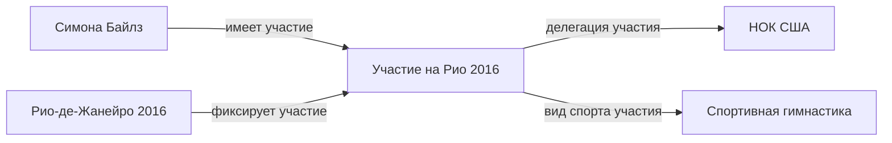

# Граф знаний OLYMPIC ATLAS

Страница `/knowledge-graph` открывает **Олимпийскую вселенную**. В режиме **Исследование связей** доступны точные отношения, соседи, происхождение фактов и поиск пути. Ссылки с `?node=Тип:ID` открывают исследование выбранного объекта. Досье Олимпиады ведёт на карту с `?edition=slug`.

## Олимпийская вселенная

### Эпохи и хронология

Каталог SQLite содержит 61 издание 1896–2026 годов. Из них 55 состоялись, пять отменены, Афины 1906 отмечены отдельным статусом. Для карты используются шесть обзорных периодов: 1896–1919, 1920–1945, 1946–1969, 1970–1989, 1990–2009 и 2010–2026. Это редакционная группировка для визуализации.

«Путь Игр» загружает календарь и показывает окно из пяти изданий. Ползунок, клавиши со стрелками и ориентиры позволяют перейти к нужной дате. Состоявшиеся Игры сортируются по фактическому году и дате начала. Для изданий без даты начала используется место в календаре по году и сезону. Токио 2020 показан с фактическим 2021 годом. Порядок изданий имеет календарную семантику. Отменённые Игры и Афины 1906 выделены отдельно.

### Сцены и запросы

`src/lib/graph/universe.ts` описывает сцены, фильтры, эпохи и семантику обзорных линий. `src/lib/repositories/universe-scope.ts` строит параметризованные запросы SQLite из периода, сезона, вида спорта, страны или НОК и контекста выбранного узла. `src/lib/repositories/universe.ts` возвращает ограниченные сцены и собирает их из тех же записей, которые использует исследование связей.

1. Сервер передаёт обзор из шести карточек. При открытии эпохи приходят только её издания и агрегаты.
2. Издание раскрывается в группы видов спорта, дисциплин, исторических НОК и стран, спортсменов, участий, соревнований, команд, результатов и источников. Пустые группы скрываются.
3. Спорт, дисциплина и делегация уточняют контекст следующей выборки. Виды спорта упорядочены по числу участий в выбранном срезе. Остальные списки используют стабильную сортировку по полю сущности и её ID.
4. Запросы в `/api/olympic-universe` возвращают до 12 записей кластера и один узел контекста. Сцена в целом ограничена 18 узлами. Ответы для сцены, календаря и списка фильтров используют браузерный кэш на 60 секунд. Фото загружается для выбранного спортсмена в инспекторе.
5. Поиск возвращает до 15 совпадений. Для объекта со спортивными записями открывается ближайшее к концу календаря подходящее издание, а для спортсмена с записью участия восстанавливаются вид спорта и кластер спортсменов. Профиль без привязки к изданию открывается самостоятельно.

### Агрегация и источники

- Число спортсменов внутри эпохи или издания вычисляется по уникальным ID в участиях, индивидуальных медальных результатах и зафиксированных составах команд. В карточке вида спорта показано число уникальных спортсменов с записями участия. Медальный результат команды учитывается одной строкой.
- Привязка страны проведения читается из `OlympicEdition.hostCountryId`. Историческая делегация берётся из участия, результата или команды. При фильтре по стране связанные НОК определяются по явному `countryId`. Страна профиля спортсмена показывается отдельно.
- Кластеры и линии между уровнями строятся при чтении. В инспекторе различаются визуальные агрегаты, производные связи через записи, прямые факты SQLite, цитаты и календарные переходы. Для прямых фактов инспектор использует механизм доказательств исходного графа. Источники группируются по `KnowledgeSource`, сохраняя поля и примечания каждого `FactCitation`.
- Инспектор показывает объём локальной выборки отдельно от числа узлов на сцене. В блок официальной статистики попадают поля издания с подтверждающей цитатой уровня `OFFICIAL`. Историческое покрытие спортивных фактов частичное, даже когда календарь изданий полный. У спортсменов без записанных участий могут быть доступны биографические источники.

### Сценарий обзора

Откройте «Новейшая история» → «Париж 2024» → «Виды спорта» → «Плавание» → «Спортсмены». Выберите профиль, затем откройте «Источники» или «Исследовать точные связи». Хлебные крошки возвращают к любому уровню. Кнопка «Список узлов» даёт доступ к тем же карточкам в виде списка. На мобильных устройствах сведения открываются в выдвижном инспекторе.

## Исследование связей

В этом режиме каждое ребро имеет направление, тип и ссылку на запись, из которой построено. Один спортсмен может иметь несколько участий за разные НОК. Команда может иметь один медальный результат и несколько участников. Превью на главной по-прежнему показывает до шести реальных узлов этого графа и подгружает полотно при приближении к секции.

## Узлы и отношения

| Откуда | Куда | Что хранится |
| --- | --- | --- |
| `OlympicEdition` | `Country` | Страна проведения из `hostCountryId` |
| `OlympicEdition` | `Event`, `Participation` | Соревнование или участие с указанным `editionId` |
| `Athlete` | `Country` | Биографическая привязка из `countryId` |
| `Athlete` | `Participation` | Конкретная запись участия из `athleteId` |
| `Participation` | `NationalOlympicCommittee`, `Sport` | НОК и вид спорта именно этого выступления |
| `NationalOlympicCommittee` | `Country` | Явная привязка НОК к стране, если она записана |
| `Event` | `Discipline` | Дисциплина соревнования |
| `Discipline` | `Sport` | Вид спорта, к которому относится дисциплина |
| `MedalResult` | `Event`, `NationalOlympicCommittee` | Соревнование и НОК, указанные в результате |
| `MedalResult` | `Athlete` или `Team` | Получатель. У командной награды одна строка результата |
| `Team` | `OlympicEdition`, `Event`, `NationalOlympicCommittee` | Издание, соревнование при его наличии, делегация команды |
| `Team` | `Athlete` | Проекция записи `TeamMember` |
| Цитируемый узел | `KnowledgeSource` | Цитата поля из `FactCitation` |

## Построение и чтение

`src/lib/repositories/graph.ts` описывает допустимые типы и отношения. Параметризованные запросы Prisma читают записи по внешним ключам в обе стороны. Идентификатор узла имеет вид `Тип:ID`, идентификатор ребра — `тип-отношения:ID-строки`. Узлы и рёбра объединяются по этим идентификаторам. Несколько цитат разных полей одного объекта могут ссылаться на один источник, сохраняя отдельные записи происхождения.

Начальный обзор строится вокруг последнего издания с участиями. На главную передаётся до шести узлов. Полный граф получает соседей по запросу через `/api/knowledge-graph`, по 12 рёбер на страницу, максимум 100 страниц на объект. Полотно ограничено 72 узлами и 160 рёбрами. Поиск возвращает до 16 совпадений в выбранных типах. Новые узлы раскладываются по колонкам на основе расстояния от фокуса. Карточки можно перемещать и центрировать вручную.

## Происхождение фактов

Инспектор ребра показывает таблицу, идентификатор строки и поля связи. Записанный внешний ключ, проекция `TeamMember` и цитата показываются разными типами. Если подходящая по полю или области записи цитата найдена, инспектор показывает её название, издателя, уровень надёжности, примечание и прямой URL. Например, цитата `participation` относится к записи участия, а `biography` — к биографическим сведениям. Биографическая цитата сама по себе не подтверждает выступление или медаль.

Источники берутся из `KnowledgeSource` и `FactCitation`. В базе представлены материалы IOC/Olympics и структурированные данные Wikidata для базовых профилей. Узлы источников не используются как переходы в спортивных маршрутах.

## Поиск пути

BFS ведёт очередь узлов, запоминает посещённые идентификаторы и предыдущее ребро. Алгоритм проходит отношения в обе стороны, а интерфейс сохраняет их исходные направления. Максимум составляет 6 рёбер, 160 посещённых объектов и 64 соседних ребра за шаг. При срабатывании ограничения по объёму интерфейс сообщает, что поиск был усечён. Отсутствие маршрута в этой выборке не доказывает отсутствие исторической связи.

## Примеры исследования

1. Найти «Париж 2024», открыть соревнование «100 м» и раскрыть ребро к результату Жюльен Альфред.
2. Задать «Симона Байлз» и «Рио-де-Жанейро 2016» как концы пути. Результат проходит через узел участия. В инспекторе можно открыть официальный материал, относящийся к этой записи.
3. Найти «Карим Фуад» по альтернативному имени и посмотреть имеющиеся связи профиля. В текущем наборе у него отсутствуют отдельные строки участия и медалей.
4. Выбрать «США» и «Спортивная гимнастика», затем изучить все промежуточные отношения найденного пути. Биографическая привязка к стране и олимпийское представительство НОК читаются отдельно.

Граф сохраняет контекст и происхождение каждого шага между объектами, поэтому из него можно составить проверяемый ответ по нескольким таблицам. Типизированные отношения, идентификаторы строк и цитаты образуют основу для следующего этапа. Поиск пути здесь отвечает только за навигацию по записанным фактам.
