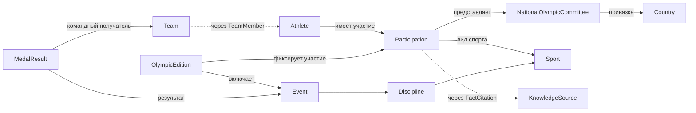
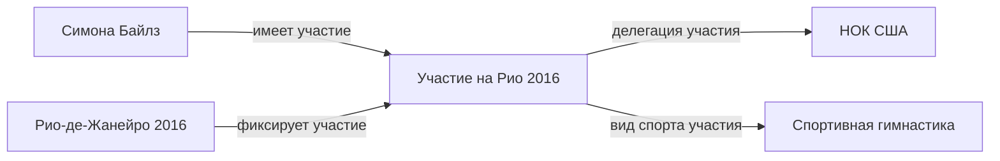

# Граф знаний OLYMPIC ATLAS

Страница `/knowledge-graph` позволяет изучать олимпийские факты из локальной SQLite. Каждая связь имеет направление, тип и ссылку на запись, из которой построена. Один спортсмен может иметь несколько участий за разные НОК. Команда может иметь один медальный результат и несколько участников.

На момент проверки этапа №9 в базе **575 узлов и 1 230 связей**. Часть связей ведёт к цитатам конкретных полей и результатов. Размер отображаемого фрагмента и общие значения вычисляются отдельно. React Flow для превью главной подгружается по мере приближения к секции.

## Узлы и отношения

| Откуда | Куда | Что хранится |
| --- | --- | --- |
| `OlympicEdition` | `Country` | Страна проведения из `hostCountryId` |
| `OlympicEdition` | `Event`, `Participation` | Соревнование или участие с указанным `editionId` |
| `Athlete` | `Country` | Биографическая привязка из `countryId` |
| `Athlete` | `Participation` | Конкретная запись участия из `athleteId` |
| `Participation` | `NationalOlympicCommittee`, `Sport` | НОК и вид спорта именно этого выступления |
| `NationalOlympicCommittee` | `Country` | Явная привязка НОК к стране, если она записана |
| `Event` | `Discipline` | Дисциплина соревнования |
| `Discipline` | `Sport` | Вид спорта, к которому относится дисциплина |
| `MedalResult` | `Event`, `NationalOlympicCommittee` | Соревнование и НОК, указанные в результате |
| `MedalResult` | `Athlete` или `Team` | Получатель. У командной награды одна строка результата |
| `Team` | `OlympicEdition`, `Event`, `NationalOlympicCommittee` | Издание, соревнование при его наличии, делегация команды |
| `Team` | `Athlete` | Проекция записи `TeamMember` |
| Цитируемый узел | `KnowledgeSource` | Цитата поля из `FactCitation` |

## Построение и чтение

`src/lib/repositories/graph.ts` описывает допустимые типы и отношения. Параметризованные запросы Prisma читают записи по внешним ключам в обе стороны. Идентификатор узла имеет вид `Тип:ID`, идентификатор ребра — `тип-отношения:ID-строки`. Узлы и рёбра объединяются по этим идентификаторам. Несколько цитат разных полей одного объекта могут ссылаться на один источник, сохраняя отдельные записи происхождения.

Начальный обзор строится вокруг последнего издания с участиями. На главную передаётся до шести узлов. Полный граф получает соседей по запросу через `/api/knowledge-graph`, по 12 рёбер на страницу, максимум 100 страниц на объект. Полотно ограничено 72 узлами и 160 рёбрами. Поиск возвращает до 16 совпадений в выбранных типах. Новые узлы раскладываются по колонкам на основе расстояния от фокуса. Карточки можно перемещать и центрировать вручную.

## Происхождение фактов

Инспектор ребра показывает таблицу, идентификатор строки и поля связи. Записанный внешний ключ, проекция `TeamMember` и цитата показываются разными типами. Если подходящая по полю или области записи цитата найдена, инспектор показывает её название, издателя, уровень надёжности, примечание и прямой URL. Например, цитата `participation` относится к записи участия, а `biography` — к биографическим сведениям. Биографическая цитата сама по себе не подтверждает выступление или медаль.

Источники берутся из `KnowledgeSource` и `FactCitation`. В базе представлены материалы IOC/Olympics и структурированные данные Wikidata для базовых профилей. Узлы источников не используются как переходы в спортивных маршрутах.

## Поиск пути

BFS ведёт очередь узлов, запоминает посещённые идентификаторы и предыдущее ребро. Алгоритм проходит отношения в обе стороны, а интерфейс сохраняет их исходные направления. Максимум составляет 6 рёбер, 160 посещённых объектов и 64 соседних ребра за шаг. При срабатывании ограничения по объёму интерфейс сообщает, что поиск был усечён. Отсутствие маршрута в этой выборке не доказывает отсутствие исторической связи.

## Примеры исследования

1. Найти «Париж 2024», открыть соревнование «100 м» и раскрыть ребро к результату Жюльен Альфред.
2. Задать «Симона Байлз» и «Рио-де-Жанейро 2016» как концы пути. Результат проходит через узел участия. В инспекторе можно открыть официальный материал, относящийся к этой записи.
3. Найти «Карим Фуад» по альтернативному имени и посмотреть имеющиеся связи профиля. В текущем наборе у него отсутствуют отдельные строки участия и медалей.
4. Выбрать «США» и «Спортивная гимнастика», затем изучить все промежуточные отношения найденного пути. Биографическая привязка к стране и олимпийское представительство НОК читаются отдельно.

Граф сохраняет контекст и происхождение каждого шага между объектами, поэтому из него можно составить проверяемый ответ по нескольким таблицам. Типизированные отношения, идентификаторы строк и цитаты образуют основу для следующего этапа. Поиск пути здесь отвечает только за навигацию по записанным фактам.
