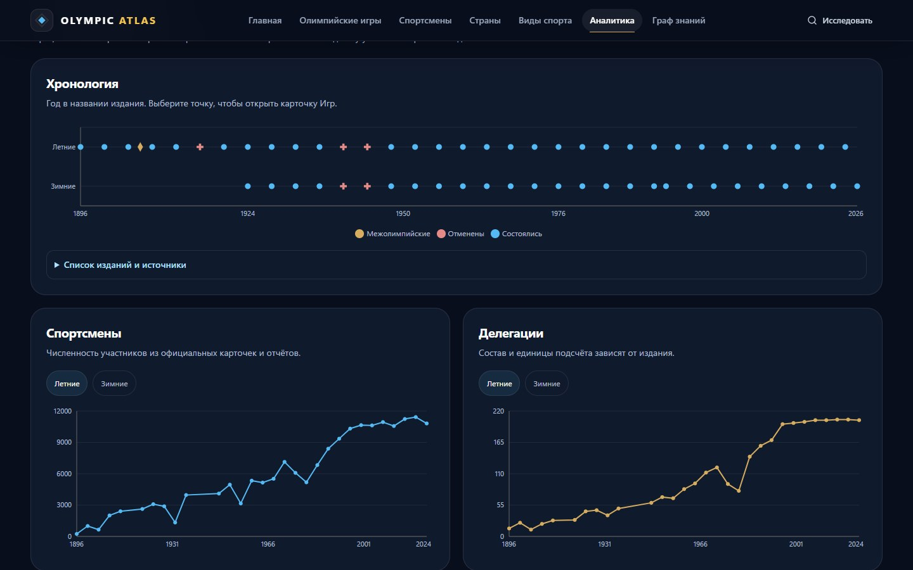

# OLYMPIC ATLAS

Интерактивная база знаний об Олимпийских играх. Приложение связывает издания, спортсменов, страны, олимпийские делегации, виды спорта, события, результаты и официальные источники.

> Независимый университетский проект. OLYMPIC ATLAS не является официальным сайтом Международного олимпийского комитета и не связан с ним.

[Исходный код на GitHub](https://github.com/sandrakula/olympic-atlas) · [Обзор курсовой](./COURSE_PROJECT_OVERVIEW.md) · [Сценарий защиты](./DEMO_SCENARIOS.md)




## Возможности

- Каталоги Игр, спортсменов, стран и видов спорта с карточками и ссылками на источники.
- Граф знаний с поиском узлов, соседей и путей между сущностями.
- Вопросы на русском языке с десятью правилами логического вывода и полнотекстовым поиском SQLite FTS5.
- Историческая аналитика и попарные сравнения Игр, спортсменов и делегаций.

## Стек

- Next.js 16 App Router, React 19, TypeScript
- Tailwind CSS 4, shadcn/ui-совместимые компоненты, Motion
- Prisma ORM 7, SQLite FTS5 и `@prisma/adapter-better-sqlite3`
- React Flow и Recharts

## Первоначальная настройка

Для воспроизводимого запуска используйте Node.js 24 и npm. В PowerShell используйте `Copy-Item .env.example .env` вместо `cp`.

```bash
npm ci
cp .env.example .env
npm run db:generate
npx prisma migrate deploy
npm run db:seed
npm run dev
```

На Windows `prisma.config.ts` преобразует относительный SQLite URL в абсолютный путь. База создаётся в `prisma/dev.db`; файл исключён из Git. Откройте [http://localhost:3000](http://localhost:3000).

Если миграция уже существует (как в репозитории), для чистой локальной базы можно применить её без создания новой:

```bash
npx prisma migrate deploy
npm run db:seed
```

Seed идемпотентен: повторный запуск обновляет записи по стабильным ключам и не создаёт дубликаты.

## Команды

```bash
npm run dev          # локальная разработка
npm run typecheck    # TypeScript
npm run lint         # ESLint
npm test             # тесты репозиториев и целостности
npm run db:validate  # проверка Prisma schema
npm run db:status    # статус миграций
npm run db:seed      # воспроизводимое наполнение
npm run db:import-athletes -- --limit=300 --batch=40 # возобновляемый импорт Wikidata/Commons
npm run build        # production build
npm run test:e2e     # браузерные сценарии после сборки
```

## Реализованные маршруты

- `/` — серверные показатели и избранные издания из SQLite;
- `/games` — полный исторический каталог 1896–2026, интерактивная шкала, поиск, фильтры, сортировка и график участия;
- `/games/[id]` — история издания, официальные агрегаты, локальная выборка результатов, изображения с лицензиями, источники и навигация;
- `/athletes` и `/athletes/[id]` — пагинация, поиск, фильтры, лицензированные фото и профили;
- `/compare/athletes` — сравнение двух профилей и диаграмма подтверждённых медалей;
- `/countries` и `/countries/[code]` — государства, исторические НОК и связанные спортсмены;
- `/sports` — виды спорта, дисциплины, издания и спортсмены;
- `/analytics` — хронология, официальные показатели Игр, локальные медали, профили и покрытие источников;
- `/compare/games` и `/compare/countries` — сравнения изданий, стран и исторических делегаций. [Методика аналитики](./ANALYTICS.md);
- `/knowledge-graph` — граф из SQLite с поиском сущностей, раскрытием соседей, источниками и поиском пути. [Модель и лимиты](./KNOWLEDGE_GRAPH.md);
- `/explore` — полнотекстовый поиск SQLite FTS5 и десять правил ответов с источниками и цепочками графа. [Модель поиска и вывода](./REASONING_ENGINE.md).

Каталог содержит 61 историческую запись: 55 состоявшихся изданий (30 летних и 25 зимних), пять отменённых и внеочередные Афины 1906. Официальные агрегаты изданий отделены от демонстрационной локальной выборки спортсменов и результатов. Подробное покрытие и ограничения описаны в [DATA_COVERAGE.md](./DATA_COVERAGE.md), архитектура происхождения фактов и ER-диаграмма — в [KNOWLEDGE_BASE.md](./KNOWLEDGE_BASE.md), общий план системы — в [ARCHITECTURE.md](./ARCHITECTURE.md).

## Структура данных

```text
prisma/
├── migrations/20261121170000_init_knowledge_base/migration.sql
├── migrations/20261121185551_extend_olympic_catalog/migration.sql
├── data/olympic-editions.ts
├── schema.prisma
└── seed.ts
src/
├── app/                    # Server Components, маршруты и error states
├── components/             # дизайн-система и визуализации
├── generated/prisma/       # локально генерируется, не коммитится
└── lib/
    ├── prisma.ts           # singleton Prisma Client
    └── repositories/       # безопасные серверные запросы
tests/                      # проверки репозиториев и связей
```

## Импорт спортсменов

`scripts/import-athletes.ts` получает идентификаторы олимпийцев через Wikidata Query Service и читает сущности пакетами через Wikidata API. Фотография сохраняется только после проверки метаданных Wikimedia Commons; разрешены CC BY, CC BY-SA, CC0 и public domain, вместе с автором, источником и лицензией. Контрольная точка и журнал находятся в игнорируемом `prisma/import-state/`. Уникальный `wikidataId` и `upsert` делают повторный запуск безопасным.

Локальный срез содержит 310 профилей, 142 сохранённых адреса лицензированных фотографий Commons, 15 подтверждённых участий и 30 медальных результатов. При отказе CDN фото спортсмена заменяется инициалами, а карточка Игр использует сезонный фон. Атрибуция доступна вместе с оригиналом.

Для запуска с уже заполненной SQLite достаточно `npm run dev`. Production-режим запускается командами `npm run build` и `npm start`. Поиск в каталоге учитывает имя и альтернативные имена. Доступны фильтры по стране или НОК, спорту, изданию, сезону и медали. В сравнении можно найти профили по имени, выбрать двух спортсменов и сопоставить результаты из базы.

## Проверки и публикация

Для существующей базы `npm run db:release-audit` применяет проверенные агрегаты изданий, точечные спортивные факты и фотографию Парижа. Новый seed уже включает этот пакет.

После `npm run build` запускайте `npm run test:e2e`. По умолчанию нужен Chromium Playwright (`npx playwright install chromium`). На Windows можно использовать установленный Edge, задав `ATLAS_E2E_CHANNEL=msedge`. Тесты сами запускают локальный production-сервер на 3149 и имитируют отказ CDN.

[Результаты QA](./FINAL_QA_REPORT.md) · [Требования к размещению и переменным окружения](./DEPLOYMENT_READINESS.md).

## Публикация

Linux-образ собирается из `Dockerfile`. В Railway один экземпляр Next.js читает SQLite с постоянного тома `/data`. Согласованный снимок переносится отдельно. `ATLAS_E2E_BASE_URL` направляет браузерные тесты на развёрнутую версию.

Публичный сайт ожидает подключения Railway. [Пошаговое размещение, проверка и восстановление](./DEPLOYMENT_GUIDE.md)
